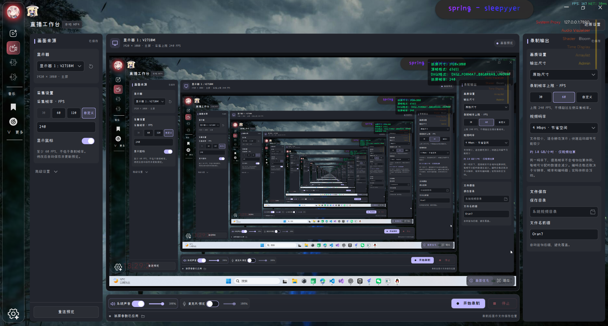
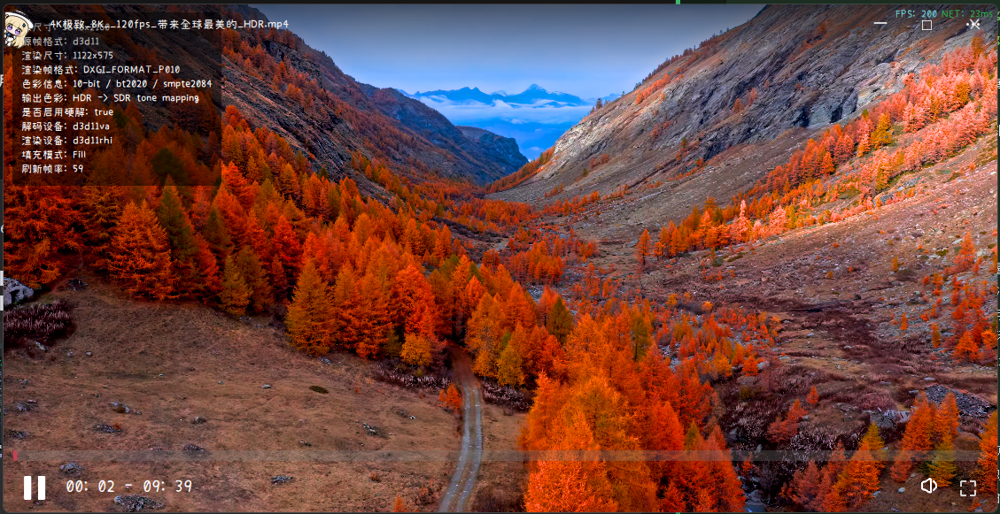

# Oran7MediaClient

**Oran柒 MediaClient · 音乐、视频与桌面录制，一个工作台。**


Oran7MediaClient 是一款面向 Windows 的桌面多媒体应用，由 C++ 与 Qt Quick / QML 构建。它把本地音乐、网易云音乐、视频播放、B 站直播观看和桌面录制放在同一个界面中，同时提供可自定义的外观、桌面歌词与音效调节。

项目仍在持续开发中，侧重日常使用体验与界面细节。

## 界面展示

**桌面录制 / 直播工作台**

来源设置、实时预览与输出参数集中呈现，当前已支持本地 MP4 录制。



**HDR 高位深视频播放**

支持高位深画面处理与 HDR / SDR 输出适配，下图为实际播放界面。截图为静态展示，不代表原始 HDR 亮度或视频帧率测试结果。



## 能做什么

### 🎵 音乐与桌面歌词

- 管理本地曲库，支持音乐搜索、网易云登录与喜欢的音乐列表。
- 提供顺序、随机、单曲循环，以及心动、私人漫游、熟悉、探索等网易云推荐入口。
- 音乐列表支持多选、拖拽排序，以及背景、文字和强调色自定义。
- 灵动岛式桌面歌词：逐句滚动、文字渐显，空闲时展示「曲名 - 作者」，悬停展开播放控制。
- 内置 10 段均衡器、音效预设及其他声音处理选项，调整实时生效。

### 🎬 视频空间

- 播放本地视频，支持画面适应 / 填充与全屏观看。
- 保存最近播放与观看进度，重启后可快捷继续观看。
- 生成并缓存真实视频缩略图，支持 HDR 素材的封面色调映射。
- 支持高位深视频与 HDR 渲染；原生 HDR 输出需要显示器支持并在 Windows 中启用 HDR。
- 输入 B 站直播间号即可观看，提供直播间信息、历史入口与弹幕展示。
- 鼠标静止时自动收起播放控件，随后隐藏光标，减少画面干扰。

### 🖥️ 桌面录制工作台

- 基于 D3D11 桌面采集，提供实时预览与显示器选择。
- 可设置录制分辨率、帧率、视频码率，输出 MP4 文件。
- 支持录制系统声音，常用设置自动保存。
- 工作台采用来源、预览、输出三区布局，底部集中放置音频和录制控制。

### 🎨 外观与设置

- 支持图片 / 视频背景、窗口毛玻璃与自定义界面配色。
- 独立下拉式设置窗口，提供颜色预设与自定义取色。
- 支持中文 / English 切换，以及字体和基础字号调整。
- 启动加载窗口、窗口位置与尺寸记忆，让日常打开和使用更连贯。

## 后续方向

直播工作台的 **B 站 RTMP 推流**、麦克风采集与混音仍在规划中，尚未实装。已有麦克风及部分音量控件为界面预留，不代表录音后端已经接通。

后续计划研发**跨平台音乐播放器**，进一步打磨音乐播放、曲库与歌词体验。当前版本仍仅支持 Windows，其他平台的适配范围与发布时间尚未确定。

## 技术与构建

主要技术：**C++17 · Qt 6.7.3 · QML · FFmpeg 6.0 · Direct3D 11 · QRhi · WASAPI**。

当前仅支持 Windows，使用 MinGW、CMake 与 Ninja 构建。准备好 Qt 和相关依赖后，在项目根目录执行：

```powershell
cmake --preset release
cmake --build --preset release
```

工具链、依赖路径与离线验证说明见 [构建与验证](<docs/BUILD - 构建与验证.md>)。工程使用本机依赖路径，首次构建前需要按文档检查配置。

## 交流与反馈

欢迎通过 [Issues](https://github.com/Oran7-qwq/Oran7MediaClient/issues) 提交问题和建议。反馈时附上复现步骤、Windows 版本及相关日志，会更方便定位。

## 许可证

项目自有代码采用 [MIT License](LICENSE)。所使用的第三方组件遵循各自许可证，相关说明见 LICENSE 与对应组件目录。
