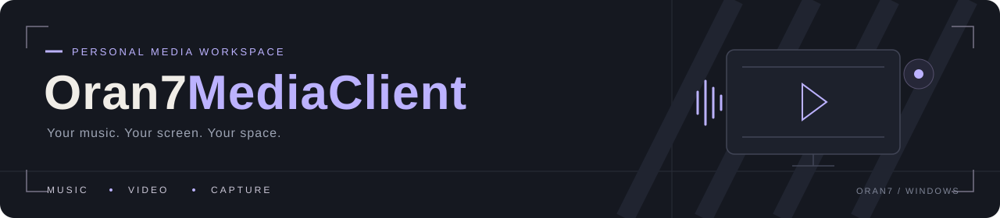

<p align="center">
  
</p>

<h1 align="center">Oran柒 MediaClient</h1>

<p align="center">
  <strong>音乐、视频与桌面录制，一个属于自己的多媒体空间。</strong>
</p>

<p align="center">
  本地曲库与网易云音乐 · 灵动岛桌面歌词 · HDR 视频 · 桌面录制
</p>

<p align="center">
  <a href="#界面预览">界面预览</a> ·
  <a href="#功能一览">功能一览</a> ·
  <a href="#后续方向">后续方向</a> ·
  <a href="#构建与文档">构建与文档</a> ·
  <a href="https://github.com/Oran7-qwq/Oran7MediaClient/issues">反馈建议</a>
</p>

<p align="center">
  
  
  
  
  <a href="LICENSE"></a>
  <br>
  
  
  
  
  
</p>

---

Oran7MediaClient 是一款基于 **C++ 与 Qt Quick / QML** 的 Windows 桌面多媒体应用。把听歌、看片、看直播和录屏放在同一个界面里，也给歌词、音效、背景与配色留下自由调整的空间。

当前处于持续开发阶段，注重日常使用体验与界面细节。

## 界面预览

### 01 / 桌面录制工作台

**左侧选择来源，中间实时预览，右侧调整输出。**

显示器切换、采集帧率、录像画质与系统声音集中呈现，常用参数自动保存。

<p align="center">
  <a href="docs/images/recording-workspace.png">
    
  </a>
</p>

<p align="center"><sub>D3D11 桌面采集 · 实时预览 · MP4 录制 · 系统声音</sub></p>

### 02 / HDR 视频空间

**从高位深解码到画面呈现，保留视频应有的色彩。**

支持 HDR 高位深画面处理、原生 HDR 输出与 SDR 色调映射；观看记录、进度和真实缩略图让下一次打开更方便。

<p align="center">
  <a href="docs/images/hdr-video-playback.png">
    
  </a>
</p>

<p align="center"><sub>高位深处理 · HDR / SDR 输出适配 · 沉浸播放 · 进度记忆</sub></p>

<details>
<summary>关于 HDR 展示</summary>

原生 HDR 输出需要显示器支持，并在 Windows 中启用 HDR。截图为实际播放界面的静态展示，不能还原原始 HDR 亮度，也不作为视频帧率测试结果。

</details>

## 功能一览

<table>
  <tr>
    <td width="50%" valign="top">
      <h3> 音乐与桌面歌词</h3>
      <p>从本地收藏到在线发现，听歌与歌词保持同步。</p>
      <ul>
        <li>本地曲库、网易云登录、搜索与喜欢的音乐。</li>
        <li>顺序、随机、单曲循环与多种推荐模式。</li>
        <li>灵动岛歌词、逐句滚动与悬停播放控制。</li>
        <li>10 段均衡器与音效预设，调整实时生效。</li>
      </ul>
    </td>
    <td width="50%" valign="top">
      <h3> 视频与直播观看</h3>
      <p>继续上次的画面，也能打开正在直播的房间。</p>
      <ul>
        <li>本地视频、全屏与适应 / 填充模式。</li>
        <li>高位深处理、HDR 输出与 SDR 映射。</li>
        <li>最近播放、观看进度与真实缩略图缓存。</li>
        <li>B 站房间号播放、房间信息与弹幕展示。</li>
      </ul>
    </td>
  </tr>
  <tr>
    <td width="50%" valign="top">
      <h3> 桌面录制工作台</h3>
      <p>采集、预览和输出，各有位置。</p>
      <ul>
        <li>D3D11 桌面采集与多显示器选择。</li>
        <li>录制分辨率、帧率与视频码率设置。</li>
        <li>本地 MP4 输出与系统声音录制。</li>
        <li>常用设置自动保存，减少重复操作。</li>
      </ul>
    </td>
    <td width="50%" valign="top">
      <h3> 外观与个性设置</h3>
      <p>背景、配色与字体，按自己的习惯调整。</p>
      <ul>
        <li>图片 / 视频背景、窗口毛玻璃。</li>
        <li>下拉式设置、颜色预设与自定义取色。</li>
        <li>中文 / English、字体与基础字号切换。</li>
        <li>音乐列表背景、文字及强调色自定义。</li>
      </ul>
    </td>
  </tr>
</table>

<details>
<summary>更多体验细节</summary>

- 网易云推荐入口：心动、私人漫游、熟悉与探索模式。
- 音乐列表支持多选与拖拽排序。
- 桌面歌词空闲时展示「曲名 - 作者」，悬停后展开播放控制。
- 视频播放时，鼠标静止会先收起标题和控制栏，随后隐藏光标。
- 启动加载窗口、窗口位置和尺寸记忆，衔接日常使用。

</details>

## 后续方向

| 方向 | 计划内容 | 当前状态 |
| :--- | :--- | :--- |
| **直播推流** | 工作台向 B 站推送 RTMP 直播流 | 方案规划 |
| **人声与混音** | 麦克风采集、系统声音与人声混合 | 方案规划 |
| **跨平台音乐播放器** | 围绕音乐、曲库与歌词体验展开跨平台研发 | 后续方向 |

当前版本仅支持 **Windows**。RTMP 推流、麦克风采集与混音尚未实装；工作台中的麦克风及部分音量控件为界面预留。跨平台适配范围与发布时间尚未确定。

## 构建与文档

| 层次 | 主要技术 |
| :--- | :--- |
| 应用与界面 | C++17 · Qt 6.7.3 · Qt Quick / QML |
| 音视频 | FFmpeg 6.0 · Direct3D 11 · QRhi · WASAPI |
| 构建 | CMake · Ninja · MinGW |

<details>
<summary><strong>从源码构建（Windows / Release）</strong></summary>

准备好 Qt 与项目依赖后，在项目根目录执行：

```powershell
cmake --preset release
cmake --build --preset release
```

工程使用本机依赖路径，首次构建前需检查工具链与依赖配置。完整说明见 [构建与验证](<docs/BUILD - 构建与验证.md>)。

</details>

## 交流与反馈

欢迎通过 [Issues](https://github.com/Oran7-qwq/Oran7MediaClient/issues) 分享建议或反馈问题。附上复现步骤、Windows 版本和相关日志，可以更快定位。

## 许可证

项目自有代码采用 [MIT License](LICENSE)。第三方组件遵循各自许可证，相关说明见 LICENSE 与对应组件目录。

---

<p align="center">
  <strong>Oran7MediaClient</strong><br>
  <sub>听喜欢的音乐，看想看的画面。</sub>
</p>
