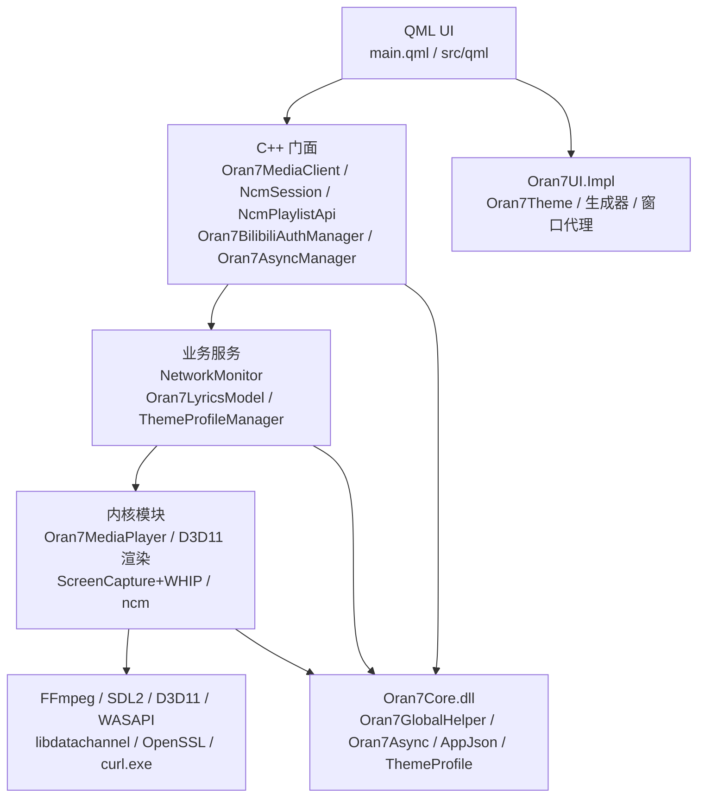

# 整体架构（ARCHITECTURE）

> 本文回答三个问题：程序由哪几块拼成、依赖方向是什么、启动/退出时按什么顺序发生什么。
> 具体模块内部设计见 [[MODULES - 模块]] 下的各模块文档；状态与线程的横向规则见 [[RUNTIME_STATE - 运行时状态]]、[[ASYNC - 异步与线程]]。

## 1. 运行时产物与链接关系

```
Oran7MediaClient.exe                        主程序：QML 引擎 + 全部业务/内核代码
├── Oran7Core.dll                            共享单例库（EXE 与 QML 插件共用同一份）
├── Oran7UI/Impl/Oran7UI_Implplugin.dll      QML 插件模块（import Oran7UI.Impl）
├── ffmpeg6.0/bin/*.dll                     FFmpeg 6.0 + SDL2
├── SQLite/*.dll                            QSQLITE 驱动
└── qt.conf / Qt 运行库                     由 oran7_pkt.bat 部署
```

三个 C++ 编译单元的关系：

| 目标 | 内容 | 关键约束 |
|---|---|---|
| `Oran7Core`（SHARED） | 5 个共享服务/辅助类及 Oran7Config 纯配置类型：`Oran7GlobalHelper` / `Oran7Async` / `Oran7AppConfigManager` / `Oran7ThemeProfileManager` / `Oran7LogSink` | 这两个目标里**唯一一份**单例实现，靠 `WINDOWS_EXPORT_ALL_SYMBOLS` 导出；新增"必须跨 EXE+插件共享"的单例要加进 `ORAN7_CORE_SOURCES`，否则 EXE 与插件各持一份，退出时会出现两套线程池/两套配置 |
| `Oran7UI_Impl`（QML 插件） | `src/cpp/QtQuicCppExtend/` 全部源文件（`CMakeLists.txt:185-203`） | 通过 `QML_SINGLETON`/`QML_NAMED_ELEMENT` 编译期导出，QML 侧 `import Oran7UI.Impl` |
| `Oran7MediaClient`（EXE） | `main.cpp` + `main.qml`/qrc + **glob 进来的 `src/cpp/**`** + `src/ncm/**`（`CMakeLists.txt:131`、`:171`） | `CONFIGURE_DEPENDS`：新增 `.cpp/.h` 不用重新 configure |

`QtQuicCppExtend/` 的导出类型在 P2-4 后仅编译于 Oran7UI_Impl。Oran7Theme 保留 P0 的共享单实例、CppOwnership 及 post routine 清理；P2-5 已实施类型化表达式、按变化分组通知、深色单源与 profile v2 差量。

其他扩展的双编译仍需两边验证，本轮没有重组整个扩展模块。

## 2. 模块分层与依赖方向



依赖规则（现状被遵守的部分，也是后续改动必须保持的）：

1. **只能向下依赖**。`ncm` 五层严格 `session → api → protocol → {crypto, network}`；`network` 不认识业务，`crypto` 不认识网络。
2. **QML 只认门面**。QML 不直接 `new` 内核对象，播放/录屏/网络都经过 `Oran7MediaClient` 或已注册单例的 `Q_INVOKABLE`。
3. **共享层只有 `Oran7Core`**。跨 DLL 的全局状态（线程池、退出标志、配置、主题 profile）必须落在这里。
4. **内核模块不反向依赖 UI**。例外是 `Oran7ScreenCapture.h:14` 直接包含 `D3d11Videoitem.h`，这是当前唯一的横向耦合（见 [[Capture - 录屏与推流]]）。

破坏方向的已知位置（重构时要处理，详见 [[REFACTOR - 重构路线]]）：

- `Oran7MediaClient` 同时是 UI 门面、播放控制器、本地曲库、配置读写器、录屏桥、D3D 槽位管理者（`src/cpp/Oran7MediaClient/Oran7MediaClient.h`，2050 行实现）；
- `Oran7FFplayerCore` 直接调用 `Oran7BilibiliAuthManager::ffmpegCookieString()` / `NcmSession::ffmpegCookieString()` 注入 Cookie（`src/cpp/Oran7MediaPlayer/Oran7FFplayerCore.cpp:209-232`）——内核反向依赖了业务单例；
- QML 里承担了播放决策、网易云缓存策略、焦点仲裁等业务策略（见 [[UI - QML界面]]）。

## 3. 启动流程（`main.cpp`）

| 步骤 | 位置 | 说明 |
|---|---|---|
| 1 | `main.cpp:88-124` | 控制台 UTF-8、DWM/DPI、崩溃 minidump handler（`Oran7MediaClient_crash.dmp`，全内存） |
| 2 | `main.cpp:126-146` | 环境变量：`QSG_RENDER_LOOP=basic`、`QSG_NO_VSYNC=1`、`QT_MEDIA_BACKEND=windows`、`QT_LOGGING_RULES` |
| 3 | `main.cpp:153-165` | `QSurfaceFormat`（GL 3.3 兼容、alpha 16、无 MSAA）+ `ATTACH_CONSOLE` + `setDefaultAlphaBuffer(true)` |
| 4 | `main.cpp:167-176` | 创建 `QGuiApplication`，强制 `Direct3D11` 场景图后端、Fusion 风格、应用名/组织名 |
| 5 | `main.cpp:178` | `Oran7ApplicationContext::instance()` → `new Oran7MediaClient("127.0.0.1", 55711)` → Client 组合各服务，采集桥独占控制器并先创建后接线；旧 TCP 会话默认停用，不建立连接或打开旧库 |
| 6 | `main.cpp:180-253` | 全部 `qmlRegister*`：QML 单例（`BasicConfig`/`Oran7MainUiSetting`）、C++ 类型（`BilibiliRoomAddressCatch`/`BilibiliDanmakuClient`/`D3D11VideoItem`/`Oran7LyricsModel`/`Oran7Sound`）、业务单例（`BilibiliAuth`/`Oran7NetEaseAuth` 三个/`Oran7Network`/`Oran7Async`） |
| 7 | `main.cpp:256-259` | `Oran7GlobalEventFilter` 安装到 app + 暴露为上下文属性 `globalEventFilter` |
| 8 | `main.cpp:262-274` | 注册 `Oran7MediaClient` 单例（返回 `Oran7ApplicationContext` 持有的指针，`CppOwnership`） |
| 9 | `main.cpp:277-291` | 检查 `QSQLITE` 驱动；注册 `image://ncmqr` provider（同时确保 `NcmSession` 先实例化） |
| 10 | `main.cpp:295` | `engine.load("qrc:/main.qml")` |
| 11 | `main.cpp:297-299` | `Config_AppConfigManager_Load`：见下 |
| 12 | `main.cpp:301-338` | 注册 `aboutToQuit` 清理链：停播放器 → `Oran7Async::beginShutdown()` → `Oran7AsyncManager::beginShutdown()` → 保存/清理 B站、网易云、网络监测 → 保存配置 → `waitForDone()`；旧 TCP 模块停用，无子树 Socket 遍历 |

`Config_AppConfigManager_Load`（`main.cpp:347-374`）的顺序是硬约束：

```
Oran7AppConfigManager::ins().loadConfig()          // 首次访问即加载；此处幂等确认
  → 窗口位置/尺寸 → 创建 AppData 目录 → 本地曲库排序
  → searchLocalMediaFiles()（异步扫描）
  → 恢复上次播放 → 音量 → 抓屏参数（依赖 loadConfig）
  → Oran7BilibiliAuthManager::loadCookies()
  → NcmSession::load()
  → Oran7NetworkMonitor::start()             // 联网且延迟<180ms 时校验 Cookie
```

## 4. 退出流程（顺序不能改）

`main.cpp:301-338`，每一步都在解决一个真实崩溃/挂死：

1. `Oran7MediaClient::stopPlayerRunning()` —— 先杀播放器，防止 `Video_refresh` 线程回调仍在触碰 QML 渲染对象（UAF）。
2. `Oran7Async::beginShutdown()` —— 置位后 `Oran7Async::run` 不再投递业务任务；P2-2 日志走独立有界队列，避免退出阶段创建线程（拒绝访问）。
3. `Oran7AsyncManager::beginShutdown()` —— 取消 QML 侧待处理任务，稍后统一排空共享池。
4. `Oran7BilibiliAuthManager::saveCookies()` + `cleanup()` —— 先写回（含已修复的解码），再销毁 QNAM/QTimer。
5. `Oran7NetworkMonitor::cleanup()` / `NcmSession::cleanup()` —— 各自销毁 QNAM/QTimer/ImageProvider；顺序上监测器要先于 NcmSession 断开连接。
6. `Config_AppConfigManager_Save()` —— 保存播放焦点、排序、音量、窗口几何、B站 Cookie、`Oran7AppConfigManager::saveConfig()`。
7. `Oran7Async::waitForDone()` —— 等线程池排空。
8. 旧自定义 TCP/Server 默认停用，已移除遍历 Client 子树 abort Socket 的退出步骤。
9. `qAddPostRoutine` → `Oran7Theme::cleanup()`（清理 DLL 内的唯一主题实例）。
10. main 的 scope guard 在引擎/应用析构后关闭 Oran7LogSink，排空已接收日志并 join 专用线程。

## 5. 线程总览（详见 [[ASYNC - 异步与线程]]）

| 线程 | 归属 | 主要工作 |
|---|---|---|
| GUI 主线程 | Qt | 所有 QObject/QML、`Oran7MediaClient` 槽、定时器、网络回调、配置 I/O、录屏控制 |
| 消息线程 | `Oran7MediaPlayer::msg_thread_` | 消费 `MessageQueue`，执行 START/PAUSE/SEEK 请求，经 Controller 静态消息循环向共享值邮箱投递；GUI 校验代际 |
| 解封装线程 | `Oran7FFplayerCore::read_thread_` | `avformat_open_input` / 读包 / seek / EOF 判定 |
| 音频解码线程、视频解码线程 | `Oran7FFmpegDecoderCore` | 解码入 `sampq`/`pictq` |
| 视频刷新线程 | `Oran7FFplayerCore::video_refresh_thread_` | A/V 同步、取帧、回调渲染桥的共享帧邮箱（不捕获 Client） |
| SDL 音频回调线程 | SDL/WASAPI | 重采样、Sonic 变速、写音频、推进音频时钟 |
| D3D11 绘制线程 | Qt Quick | `beforeRendering` / `updatePaintNode` / `QSGRenderNode::render` |
| 录制采集线程 | `DdaGrabWorker` 所在 `QThread` | DXGI DDA 抓帧、共享纹理、GPU→CPU 下载、送编码器 |
| 编码/封装/推流线程 | 各自 `std::thread` | 视频编码、音频编码、MP4 封装、WHIP 发送、WASAPI 采集、音频桥 |
| `Oran7Async::pool()` | `Oran7Core` | C++ 侧通用后台任务（本地曲库扫描、旧播放器销毁）；日志由 Oran7LogSink 专用线程写入 |
| Oran7AsyncManager | QML 单例 | 无独立线程池；上述共享池执行 QML 任务，阻塞网络组最多两个并发 |

## 6. 状态分层（详见 [[RUNTIME_STATE - 运行时状态]]）

| 层 | 位置 | 权威方 | 例子 |
|---|---|---|---|
| 领域状态 | C++ | C++ | 播放位置、当前 clock、登录态、抓屏参数、曲库文件集 |
| 界面瞬时状态 | QML | QML | 是否正在播放动画、当前 hover 项、栈页 |
| 持久化状态 | `Config/config.json`、`Config/profile-*.json` | 文件 | 音量、窗口几何、主题 profile、Cookie、排序 |

**核心纪律（当前多处未满足，重构目标）**：一个事实只能有一个权威所有者；QML 不直接改写领域状态，只调 `Q_INVOKABLE`；C++ 不读控件状态；持久化只在明确的生命周期点发生。

## 7. 必须遵守的不变式

1. QObject 只在创建它的线程上使用；跨线程一律 `Qt::QueuedConnection` 或值快照。
2. 工作线程不允许触碰 QML 对象、`QJSValue`、`CookieStore`、`Oran7MediaClient::m_d3d11Slots`。
3. 新增跨 EXE/插件共享的单例 → 加入 `ORAN7_CORE_SOURCES`，并从 EXE glob 排除。
4. 新增 `.qml` / 图片 / 声音 → 手动加进 `qml.qrc` / `res.qrc`；新增主题 JSON → 至少加进插件侧的 `qt_add_resources`。
5. 新增 QML 导出类型 → `src/cpp/QtQuicCppExtend` 的 `SOURCES` 列表要加，否则插件里没有该类型（`import Oran7UI.Impl` 只认插件）。
6. 任何 `Q_INVOKABLE` 都必须在 GUI 线程返回；耗时操作走 `Oran7Async`/`Oran7AsyncManager`。

## 8. 关键架构决策索引

历史决策与理由记录在 [[ADR/README]]，已确认的：

- 匿名单例必须放 `Oran7Core`（否则 EXE/插件各一份，退出时线程池重复析构）；
- ncm 走双 HTTP 通道（系统 `curl.exe`/Schannel 过 WAF，QNAM 会被返回空 200 或 `-110`）；
- B 站弹幕必须 `uid=0` 匿名 + `protover=3`（brotli），并先预热 Cookie 站 + WBI 签名；
- 强制 `QT_MEDIA_BACKEND=windows`，避免自带 FFmpeg DLL 与 Qt Multimedia 的 ffmpeg 插件冲突；
- 播放器销毁必须离开 GUI 线程，避免 `SDL_Quit`/`avformat_close_input` 阻塞界面。

P2-7（2026-10-26）：视频/预览统一在 QRhi 节点 prepare 消费媒体帧，Item 只负责 GUI 几何与完整信息快照；每个 Qt 帧主/离屏 pass 共用同一媒体帧。采集三槽使用 AVFrame 租约及零超时 keyed mutex；worker 只持共享邮箱回调，不访问 GUI 对象。保留 Direct3D11/basic/透明窗口与现行 SDR 输出，HDR 后续独立实施。
