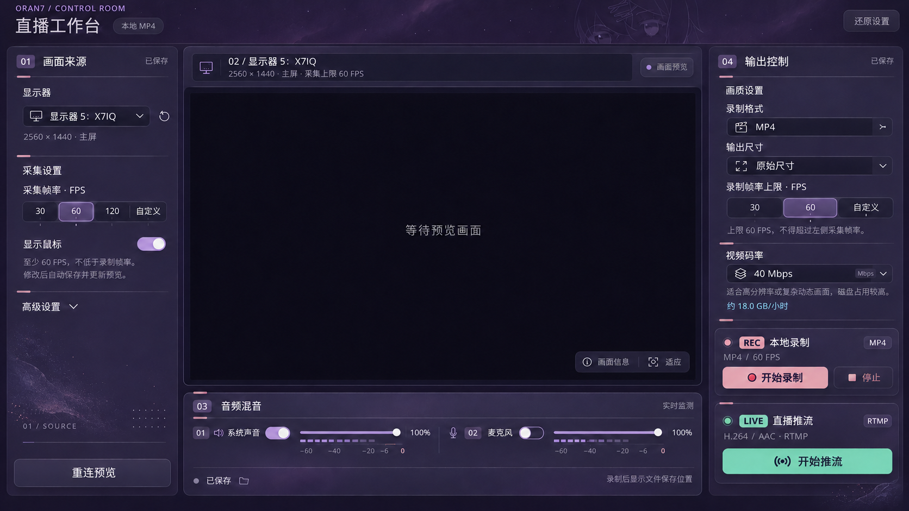

# 直播工作台皮肤设计

## 已确认的视觉方向

2026-11-17 保存此版，后续皮肤实现以此作为视觉参考，主题名称暂不确定。

早期方案保留于 `images/workspace-skin/design-v1.png`。

- 保留夜紫、雾蓝、暖粉配色，以及较淡的细颗粒材质。
- 不加入人物立绘、具象折纸、相框或电台主题素材。后续用户确认顶部保留个人形象描边水印，与星空背景共存。
- 标题使用清晰文字和小型编号标签，不使用撕纸标签底图。
- 顶部与侧栏装饰采用低对比抽象块面，缩小装饰范围。
- 输入、选择器和按钮具有统一的内嵌质感与克制的高亮反馈。
- 现有三栏、中央预览、底部混音区与右下双输出区的布局及功能保持不变。
- 正常采集画面不叠加皮肤插画；预览待机图只在没有有效预览时呈现。

原图与内置 imagegen 提示词长期保存在 `docs/images/workspace-skin/`，不依赖 build 临时目录，也不加入运行资源包。

## 设置入口

下拉式 GUI 新增独立的“直播工作台”面板，位于现有主界面、音乐播放器、视频播放器设置之后。

面板沿用现有容器的开关、ESC、拖动、方向键位移和关闭完成门控。

已添加“直播工作台主题”折叠分组，内含复用语言/字体选择器的皮肤菜单。目前提供“默认”和“紫色星云”。默认皮肤保持原样；夜紫皮肤按上述设计方向实现，并将顶部改为星空横幅。

选择通过 `Oran7ScreenCapture.workspaceSkin` 保存到主题配置，协议值为 `default` 或 `violet`，不随语言改变。缺少该键的旧配置继承默认皮肤；未识别的皮肤值按默认外观显示。菜单收起、面板隐藏和 ESC 的焦点管理沿用现有机制。

## 夜紫皮肤首版实现

- 2026-11-17：顶部采用独立星空图片 `image/skins/violet/header.png`，内置 imagegen 生成，提示词保存在 `docs/images/workspace-skin/violet-header-prompt.txt`。
- 面板与输出区使用低对比抽象曲面 SVG、共用颗粒材质；不显示圆环显示器水印。顶部个人形象描边保留原位置与反向视差，紫色皮肤以灰紫色 `#C4AEDB` 染色，沿用 18% 不透明度。
- 按钮、输入框、选择器和音频通道使用同一套内嵌高光、内边缘与纹理表皮，不只替换颜色。
- 正常采集画面不加图案；只有预览不可用遮罩使用抽象待机装饰。
- 控件占位、三栏宽度、折叠策略、音视频启停与设置保存逻辑保持原有路径。
- 默认皮肤仍为首次加载与旧配置的默认值；切换即时生效并自动保存。

## 紫色星云：面板装饰更新

- 主题显示名统一为“紫色星云”，配置值仍为 `violet`，已有选择保持有效。
- 采用半透明叠片方向，加入独立电子云/弧线光云素材 `image/skins/violet/electron-cloud.png`；来源、输出、混音区按区域裁切与镜像，避免整张重复平铺。
- 顶部星空和灰紫形象水印保留；控件前景和正常预览画面不叠加电子云。
- 云层采用静态透明贴图共用采样，不增加粒子循环、逐帧噪声或实时模糊。

### 两侧面板收敛

来源与输出面板改为复用顶部星空素材的低对比裁切，叠加紫色雾面与细颗粒；输出卡片一并撤下大幅光云。混音区保留电子云和弧线光云。默认皮肤、顶部星空与个人形象、控件和布局不变。雾面采用静态素材合成，不增加实时背景模糊。

### 光云收敛与预览清理

按后续验收反馈，紫色皮肤预览不可用时也保持纯深色，不再显示光云或颗粒装饰。混音区撤下有轮廓的光带、亮点与叠片，改用低不透明度、宽幅径向渐变的扩散雾色。左右磨砂面板、顶部星空、形象线稿和视差不变。旧电子云与曲面素材保留在源码目录供设计回溯，不再打入运行资源包。

## 星尘与矿物拓印确认稿实装

- 两侧采用独立透明素材 `image/skins/violet/mineral-dust.png`，低不透明度裁切；不使用植物、亮色光云或工程导轨。原星空、形象线稿和纯深色预览不变。
- 输入选择器增加功能图标、箭头独立槽；分区加入短标记，来源区下部加入小型编号与点阵。
- 录制/推流卡片增加状态灯槽与真实格式徽记，格式来自现有 MP4/FLV 草稿，推流仍为 RTMP。
- 混音区增加通道编号和与现有 -60～0 dBFS 映射一致的刻度，保留已有电平与峰值反馈。
- 所有改动只在 `violet` 生效；默认皮肤及设置/录制/推流业务路径不变。

### 控件材质补充

- 按后续反馈收敛为简约控件：去掉按钮矿物切面、星尘刻点、装饰线、渐变与高光叠层，改为柔和纯色底、极轻磨砂颗粒及轻微明暗反馈；输入框使用同样的纯色表面，面板上的星尘与矿物拓印不变。
- `Oran7StudioSwitch` 采用纯净轨道与圆钮，移除刻痕、多层描边和光点，切换仍使用 230ms OutCubic。保留原 checked／switchToggleChanged 接口和外部配置绑定，默认皮肤直接委托原 `Oran7SwitchToggleItem`。
- 尺寸、布局与功能不变；仅复用已有颗粒贴图，不增加实时模糊或循环粒子。

### 混音器回归默认布局

按最新确认，紫色星云与默认皮肤共用同一套混音布局及尺寸：面板高 110px，控制区高 40px，两个 32px 高的声道始终同行；控件顺序均为图标、名称、开关、音量滑块／电平条、百分比。滑块与电平条尺寸、间距、窄屏最小宽度及横向滚动方式都与默认一致。

撤回紫色皮肤独有的多行声道、面板增高、大尺寸滑块、电平刻度和通道编号。皮肤仅保留配色、磨砂材质、背景图及开关外观差异，音频设置和录制／推流业务不变。

此前输出栏的滚动范围及短窗口最小高度修复保留，两种皮肤统一使用，不随皮肤切换改变布局。

### 雪松幽境底板调整（2026-11-18）

雪松幽境沿用 `violet` 配置值。底板曾按反馈改为纯白；用户重新启用雪景后，恢复圆角雪景绘制及原来的浅冰蓝渐变覆色，避免顶部直接露出偏暗的原图。纯白仍用作图片加载前的底色，形象描边、染色和反向视差保留。原图由底板与四卡毛玻璃共用；圆角 Canvas 在重新显示时主动检查缓存并重绘，避免再次切换皮肤后缺图。默认皮肤底色与渐变、所有面板布局和业务功能保持原样。

毛玻璃雪景的共用采样尺寸按验收反馈恢复为 96×54，沿用原来的模糊强度；面板覆色、透明度不变。
